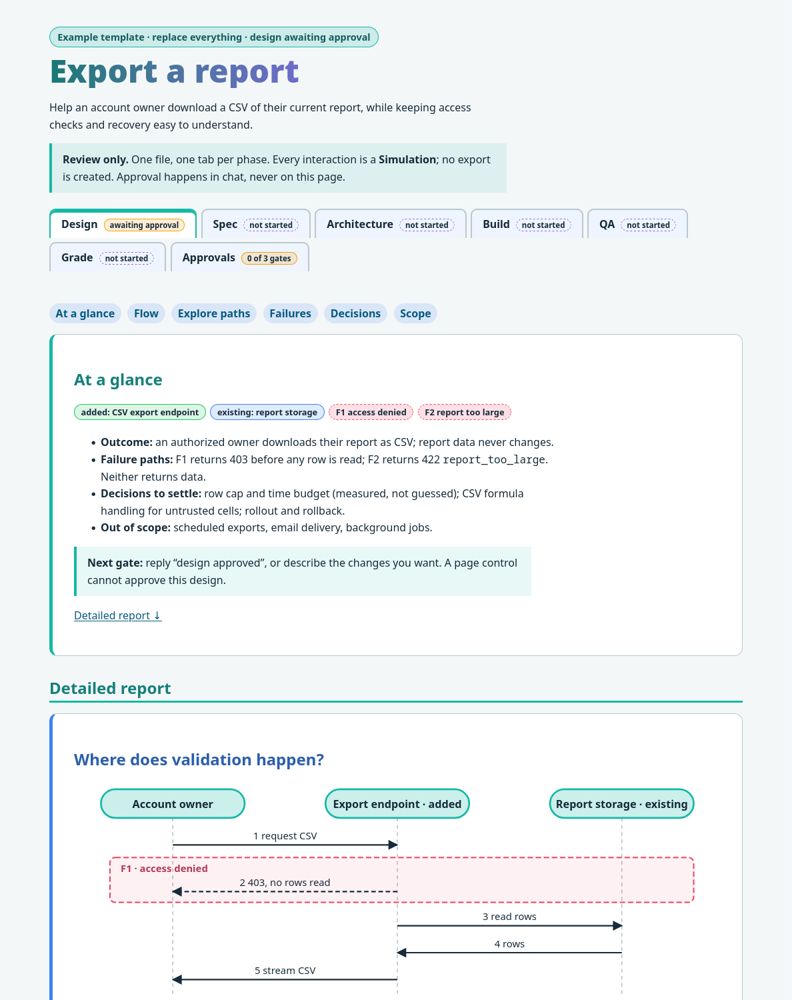
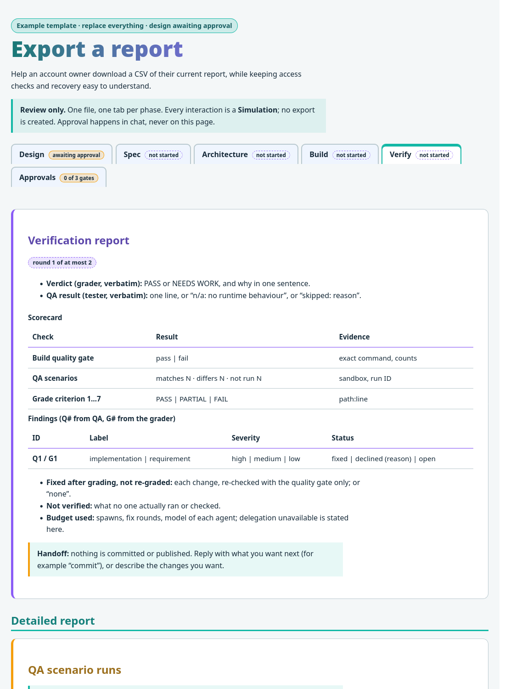

# SDD HTML Feature

A visual Spec-Driven Development skill: review a feature through a self-contained interactive HTML page before committing its behavior to a spec and its interfaces to code. It retains separate design, spec and architecture approvals, followed by tests, implementation and independent review.

One file per feature, `sdd/<feature>.html`, is the single source of truth, with a tab per phase. Each tab shows **At a glance** first, then the **Detailed report** (the Spec tab holds the full Given/When/Then; there is no separate SPEC.md or APPROVALS.md). The page works offline, uses coloured inline SVG diagrams plus text labels, follows the system light/dark theme, and keeps everything readable without JavaScript and in print. Interactive walkthroughs are simulations. Approval always happens in chat and is recorded in the Approvals tab. It suits backend, CLI, library, jobs and frontend features.

*Screenshots of `skills/sdd-html-feature/templates/feature.html` in light mode (the page also follows the system dark theme).*

| Tab | Reviewable result |
|---|---|
| Design | Flow diagram with failure frames, state walkthroughs, proposed decisions, open questions |
| Spec | Contracts, stable scenarios with full Given/When/Then, traceability |
| Architecture | Dependency diagram, interface diffs, phased plan |
| Build | Tests first, implementation, project quality gate, what is not verified |
| Verify | One combined report: grader verdict and QA result (pasted verbatim), scorecard, findings `Q#`/`G#` with resolution, not verified, handoff; the detail holds the QA scenario runs and the grader's criteria |
| Approvals | Gate approvals actually received in chat |

Agents: `agents/qa-tester.md` (runs the thing, never edits source) and `agents/code-grader.md` (reads and judges, may run only the documented quality gate). Order: implement, QA, fix, grade, fix. Both run automatically after the build (the user is told once, at the architecture gate, and can opt out with `no QA` or `no grade`); one shared budget of two fix rounds and at most three subagent runs. Every tab exists from the start and ends its glance with one `.gate` line. `scripts/inline_view.py PAGE TAB` extracts the chat report from the page (HTML, or `--format md` when the host cannot render HTML) and `--check PAGE` lints the page structure; chat never carries text that is not in the page.

Compared with [`sdd-feature`](https://github.com/illescasDaniel/sdd-feature-skill) (the Mermaid-based predecessor), this skill makes the offline HTML review the visual entry point for UI, system and CLI work. It removes CDN rendering dependencies, brings proposed decisions into design review, records revision-specific approval, and checks contracts at the layer where their behavior occurs. Existing project-mandated Markdown designs remain authoritative where required.

## Use

Ask your agent to use the skill for a feature (`/sdd-html-feature` in Claude Code, `$sdd-html-feature` in Codex). Review the saved HTML locally; an inline preview is offered when the host supports it. Do not assume every agent host can render interactive HTML inside chat.

To install manually, copy `skills/sdd-html-feature/` into your agent's skills directory: `~/.claude/skills/` (Claude Code) or `~/.agents/skills/` (Codex), or a project's `.claude/skills/` / `.agents/skills/`. The agent and script paths above are relative to that skill folder. Restart the agent session afterwards.

## Contributing

Keep approval boundaries explicit and examples offline and accessible. Validate frontmatter, exercise the HTML selector with keyboard and a narrow viewport, inspect print output, and test the skill on a realistic feature request. Report checks you could not run.

## License

MIT; see LICENSE.
