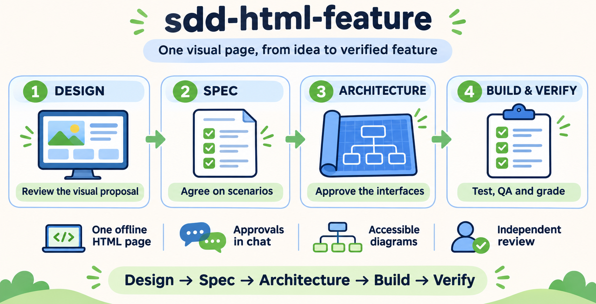
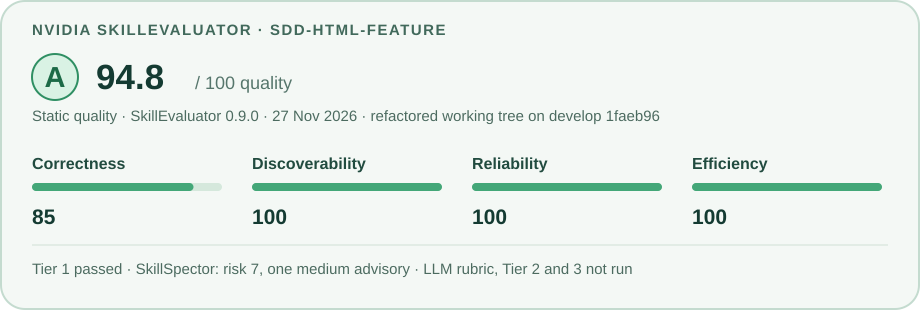

<p align="center"></p>

# sdd-html-feature

Visual spec-driven development in a single, self-contained HTML page per feature. Review the design, specification and architecture through separate approval gates, challenge the proposal with a fresh reviewer before architecture approval, then build, test and independently verify the result.

## How it works



| Phase | Reviewable result |
| --- | --- |
| Design | Visual proposal, flows, alternatives, reuse, decisions and open questions |
| Spec | Contracts, scenarios and traceability |
| Architecture | Interfaces, dependencies, file-change plan and independent proposal review |
| Build and verify | Tests, implementation, QA and independent grade |
| Approvals | The approvals received in chat |

The page is saved as `sdd/<feature>.html`, works offline and retains readable content without JavaScript. Approval happens in chat. [See the full guide and screenshots](docs/guide.md).

## Quick start

```bash
npx skills add illescasDaniel/sdd-html-feature-skill
```

Ask your agent to use `sdd-html-feature` for a feature. Review the HTML page and approve each gate in chat. See the [manual installation instructions](docs/guide.md#use).

## Requirements and limits

Python 3 runs the page checker and report extractor. Your agent host may not support inline interactive HTML; the saved page remains available locally. QA and grading use independent agents when available, with documented limits and opt-outs. A page interaction is a simulation, not an approval.

## Evaluation

[](docs/evaluation.md)

The historical keyless NVIDIA SkillEvaluator quality check gave **A, 93.5/100** (it gave C, 78.5 before the improvements), Tier 1 passes (it failed on missing author metadata and two security warnings), and SkillSpector reports no findings. The remaining deductions are evaluator conventions (a `run_script` mention, a top-level `version` field, description length). QA still runs freshly built code with instruction-based isolation, which `SKILL.md` lists under Limitations. This historical static score has not been re-measured for the current candidate and does not measure agent performance; the LLM rubric, Tier 2 and Tier 3 were not run, and the result was measured on an uncommitted working tree. [Evaluation details](docs/evaluation.md).

## Tests

Run `python3 -m unittest discover -s tests -v` for offline checks of the page checker and report extractor. These script tests do not evaluate whether an agent follows the skill or whether the page works across browsers. [Behavioral cases](evals/README.md) cover approval stops, resume, requirement reopening, proposal review and parent-context isolation; see the [run record](docs/evaluation.md#behavioral-forward-evaluations-27-november-2026) for results and limits.

## License

[MIT](LICENSE).
